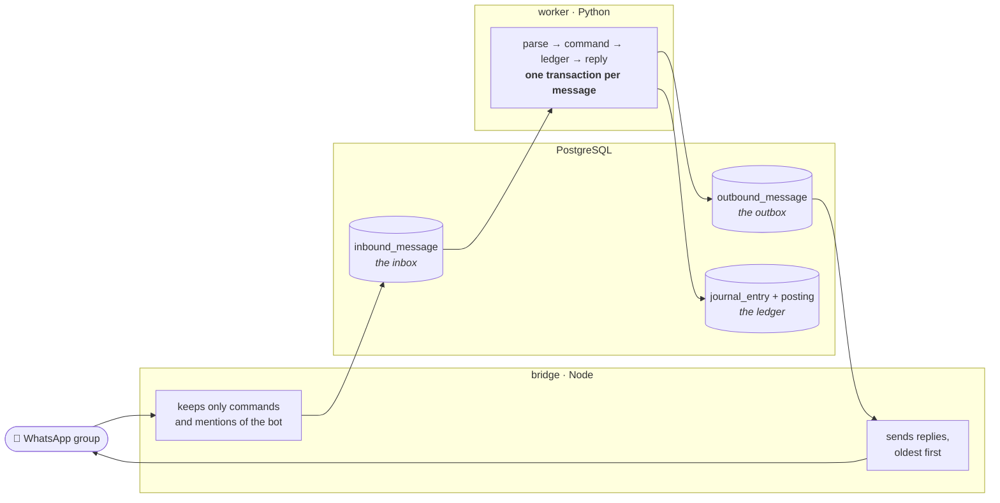
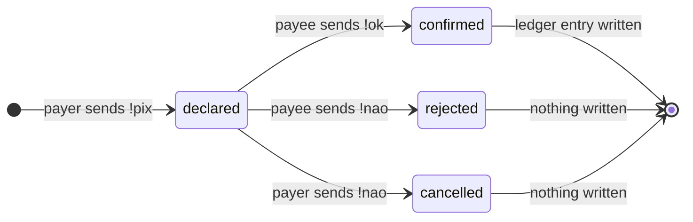
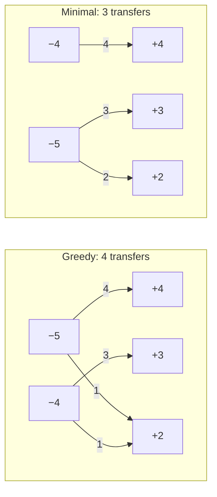
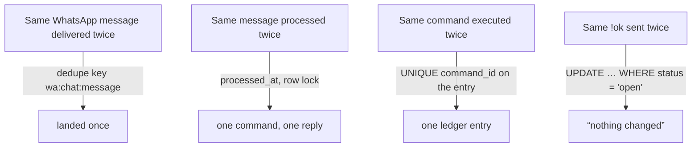
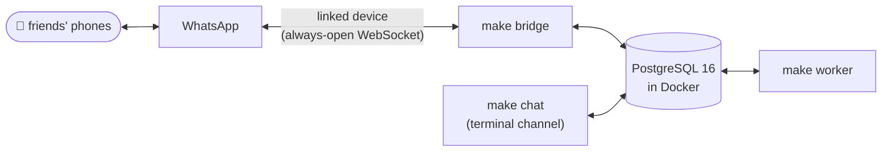
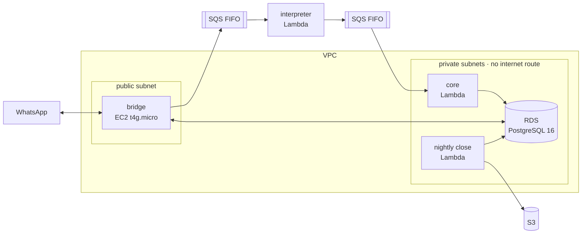

# rateio

**A WhatsApp bot that splits trip expenses among friends, built like a small financial system.**

Someone pays for dinner, says so in the group chat, and the bot keeps the books:
who paid, who owes, and the fewest transfers that settle everyone up. Under the
chat there is an append-only double-entry ledger, two-sided payment
confirmation, multilateral netting and an at-least-once message pipeline.

| | |
|---|---|
| **Status** | Works end to end on a laptop and in a real WhatsApp group. Moving to AWS is **in development** (stage 06). |
| **Stack** | Python 3.12 · PostgreSQL 16 · Node 26 + TypeScript · Baileys · pytest + Hypothesis |
| **Tests** | 465 in Python (unit, property-based, acceptance) · 35 in the bridge |
| **Purpose** | Learning first, portfolio second. Five friends, one trip in February 2027. |

---

## What it looks like

The users are Brazilian, so the bot speaks Portuguese. Everything else in this
repository is in English.

```text
👤 Lotti    !gasto 300 gasolina

🤖 Rateio   🧾 Nova despesa
            Lotti pagou R$ 300,00 de gasolina (26/12)
            Dividido entre 5 pessoas

            Para confirmar, mande:
            !ok K4

👤 Lotti    !ok K4

🤖 Rateio   ✅ Registrado: L1
            gasolina · R$ 300,00 · pago por Lotti

👤 Luis     !pix @lotti 60

🤖 Rateio   💸 Pix informado
            Luis diz que mandou R$ 60,00 para Lotti

            Lotti, se o dinheiro chegou, mande:
            !ok B3

👤 Lotti    !ok B3

🤖 Rateio   ✅ Pix confirmado: L2
            Luis pagou R$ 60,00 a Lotti
```

| Command | What it does |
|---|---|
| `!gasto 45,90 pizza` | Records an expense, split among everyone on the trip (an optional `18/02` sets the date) |
| `!pix @joao 40` | Says you paid someone. It counts only when **they** confirm |
| `!ok A7` · `!nao A7` | Confirms or declines, with the code the bot sent |
| `!estorna L5` | Undoes an entry, by adding its reversal |
| `!saldo` · `!extrato` · `!acerto` | Balances · latest entries · who pays whom to settle up |

---

## The life of a message

One message, from the group chat to the ledger and back. Each process does one
thing, and they only talk through two tables.



- **The bridge knows nothing about money.** It lands raw messages and sends the
  outbox. Who sent what, and what it means, is decided in Python.
- **One message, one transaction.** The command, its ledger entry, the reply
  and the "processed" mark are written together. If the process dies halfway,
  none of it happened and the message is processed again.
- **Either process can stop.** Messages wait in the inbox, replies wait in the
  outbox. Tested for real: commands sent while the bridge was down were
  answered once each when it came back.

---

## Built like a financial system

Six rules the whole design hangs on:

| | Rule | What it means here |
|---|---|---|
| 1 | **Double-entry, append-only** | A balance is never stored. It is a replay of every posting, every time |
| 2 | **Corrections are reversals** | Nothing is updated or deleted. A mistake is undone by a new, mirrored entry, and both stay visible |
| 3 | **Declaring a payment settles nothing** | Only the person who received the money can confirm it |
| 4 | **Integer cents** | No floats, ever. The leftover cent of a split rotates deterministically |
| 5 | **Two dates per entry** | When it happened (`occurred_on`) and when the ledger learned it (`recorded_at`) |
| 6 | **A pure domain** | `src/ledger/` imports only the standard library: no database, no WhatsApp, no clock |

### Double-entry: every entry sums to zero

There is one account per person. A dinner of R$ 300 paid by Lotti and shared by
five is six postings: Lotti paid in R$ 300 and each person, Lotti included,
consumed R$ 60.

| Person | `outlay` | `share` | Position |
|---|---:|---:|---:|
| Lotti | +300,00 | −60,00 | **+240,00** |
| Luis | | −60,00 | **−60,00** |
| Seph | | −60,00 | **−60,00** |
| Vini | | −60,00 | **−60,00** |
| Vitor | | −60,00 | **−60,00** |
| **Sum** | | | **0,00** |

R$ 187,43 split five ways is R$ 37,48 each with 3 cents left over. Those cents go
to three people chosen by the entry's sequence number, so nobody always absorbs
them and a replay always gives the same answer. Nothing is ever rounded.

### A payment is real only when the other side confirms it

This is two-sided reconciliation, the same idea a clearing house uses: a payment
declared by one side is only an intention until the counterparty confirms it.
While it waits, the ledger cannot see it, because the settlement row has no
ledger entry yet.



### Settling up with the fewest transfers

`!acerto` turns everyone's position into the shortest list of transfers that
zeroes it. The obvious greedy method (largest creditor against largest debtor)
**is not optimal**. Take positions `+4 +3 +2 −5 −4`:



The `−4` and the `+4` close on their own. The minimum is *(people who owe or are
owed) − (the largest number of groups that each sum to zero)*. Finding those
groups is NP-hard in general and instant for a group of friends. The plan is
checked against an independent brute-force oracle on hundreds of generated
cases built to hide such groups. Among plans of the same length it prefers the
one whose smallest transfer is largest, so nobody gets asked for a R$ 2,47 pix.

---

## Exactly once, in effect

WhatsApp delivers at least once, and so do queues. A duplicate is the normal
case, so every layer is built to make the second copy harmless:



Sending is the one place this cannot fully hold. The bridge sends first and marks
the reply as sent after, so a crash in between repeats a message instead of
losing it. A repeated reply is an annoyance, and a lost reply would be wrong.

---

## Architecture

### Today: a laptop and a WhatsApp group



The terminal is a real second channel (`channel = 'cli'`), so the whole flow can
be exercised without WhatsApp. A 25-message trip runs through it in the
acceptance test.

### 🚧 Next: AWS (stage 06, in development)

The plan below is designed but not built yet. Two choices shape it:

- **The bridge needs a machine that is always on**, because a linked device
  keeps a WebSocket open and WhatsApp never calls a webhook. That is an EC2
  instance and not a Lambda.
- **No NAT Gateway.** The only component that needs the internet and never
  touches the database (the interpreter) lives outside the VPC.



The whole project runs on a **US$ 140 budget**, which rules out a NAT Gateway,
RDS Proxy, Secrets Manager and a second environment.

---

## Roadmap

| Stage | What it delivers | Status |
|---|---|---|
| 00 | Postgres in Docker, migration runner with checksums, cost guard | ✅ done |
| 01 | Immutable double-entry ledger, splits in integer cents | ✅ done |
| 02 | Corrections by reversal, full statement | ✅ done |
| 03 | Two-sided settlement, confirmation for every entry | ✅ done |
| 04 | Positions and the minimal settlement plan, proven against an oracle | ✅ done |
| 05a | Grammar, Portuguese messages, inbox/outbox, terminal channel | ✅ done |
| 05b | WhatsApp bridge, correlation logs, privacy check | ✅ done |
| 06 | AWS and Terraform | 🚧 in development |
| 07 | Nightly close, restatement, payment reminders | ⏳ planned |
| 08 | Free-text messages understood by an LLM | ⏳ planned |
| 09 | Excel report | ⏳ planned |
| 10 | Freeze and operation for the trip | ⏳ planned |

---

## Quickstart

**You need:** Docker with Compose, [uv](https://docs.astral.sh/uv/), make, and
Node 26 for the bridge ([nvm](https://github.com/nvm-sh/nvm) reads
`bridge/.nvmrc`).

```bash
cp .env.example .env     # adjust POSTGRES_PORT if 5432 is taken
uv sync                  # Python dependencies
make up                  # start PostgreSQL 16
make migrate             # apply the migrations
make check               # lint, type checks and every test
```

**Talk to the bot in the terminal**, no WhatsApp needed:

```bash
make admin ARGS="create-book 'Trip' --starts 2027-02-15 --ends 2027-02-25"
make admin ARGS="add-participant lotti Lotti"
make admin ARGS="add-member 'Trip' lotti"
make admin ARGS="link-identity cli lotti lotti"
make admin ARGS="link-conversation cli trip 'Trip'"
make chat CHAT=trip AS=lotti      # /as <name> switches person, /quit leaves
```

**Run it on WhatsApp**, with a dedicated number for the bot:

```bash
make bridge-install      # pinned Node dependencies
make bridge              # first run shows a QR: scan it from the bot's phone
make worker              # in a second terminal
make bridge-groups       # with the bridge stopped: find the group to register
```

## Commands

| Command | What it does |
|---|---|
| `make up` / `make down` | Start or stop PostgreSQL (data stays in a volume) |
| `make migrate` | Apply pending migrations |
| `make check` | Everything: lint, mypy, pytest, bridge typecheck and tests |
| `make chat CHAT=… AS=…` | Talk to the bot through the terminal channel |
| `make admin ARGS="…"` | Register books, people, members, identities, chats |
| `make bridge` · `make worker` | The two processes of a WhatsApp deployment |
| `make bridge-groups [GROUP=…]` | List the bot's groups, or one group's participants |

## Project layout

```text
src/
  ledger/        the domain: entries, splits, reversals, settlement plan (stdlib only)
  store/         the only code that speaks SQL
  channel/       grammar, Portuguese messages, the WhatsApp translator
  core/          the processor and the worker loop
  cli/           the terminal channel and the operator commands
bridge/          Node + TypeScript: WhatsApp session, inbox writer, outbox sender
migrations/      numbered SQL, never edited once applied
tests/
  unit/          examples, including SQL against a throwaway database
  properties/    invariants checked by Hypothesis
  acceptance/    a whole trip through the terminal channel
  support/       the brute-force oracle and test strategies
```

## How it is tested

- **Invariants, not just examples.** Hypothesis generates random trips (expenses,
  reversals and payments in odd orders) and checks that every entry sums to zero,
  that a replay reproduces every balance, and that a pending payment changes
  nothing.
- **An independent oracle.** The settlement plan is compared with a brute-force
  search on cases built to contain hidden zero-sum groups. Random cases almost
  never contain them, and that is exactly where greedy fails.
- **A whole trip.** The acceptance test sends 25 messages through the terminal
  channel and must end on exact positions and an exact plan. Swapping two
  expenses makes it fail by one cent.
- **Privacy, as a test.** Every versioned file is scanned for real phone numbers
  and WhatsApp identifiers. The bot is used by real people, and the repository is
  public.
